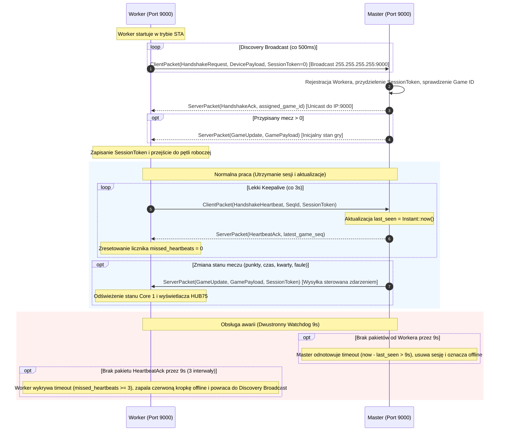

# RP235x HUB75 Wireless Scoreboard System

Dual-core RP2350 (Cortex-M33) scoreboard display nodes communicating over Wi-Fi / UDP with a central Master server and HMI control interface.

---

## 1. Quick Start / Setup Checklist
1. Connect both master and worker devices into the power socket.
2. Wait a few seconds for the master to boot up and initialize its network / UDP listener (symmetric port **9000**).
3. Power on the worker node.
   - If Wi-Fi configuration exists in Flash, the worker joins the network in STA mode and binds to port **9000**.
   - If no valid Wi-Fi config exists, the worker launches an AP hotspot (`Worker-Setup`) on port **9000** for OTA provisioning.

---

## 2. Master <-> Worker Communication Protocol

The communication protocol operates over **UDP port 9000** on both ends (symmetric port architecture) using fixed-size binary frames designed for zero-copy, allocation-free embedded execution (`no_std`).

### 2.1 Symmetric Port Architecture (Port 9000)
- **Port:** Both Master and Worker bind to UDP port `9000`.
- **Benefits:**
  - Firewalls, AP routers, and NAT state-tracking require allowing only a single symmetric port (`9000`).
  - Responses are returned directly to `peer_ip:9000` without tracking ephemeral or disparate port allocations.
  - Setup Hotspot (SoftAP) and regular STA mode share the exact same port and handler logic.

---

### 2.2 Wire Packet Specification
Packets use a compact **64-byte fixed frame** layout (`net::layout`) with CRC-16-CCITT integrity verification:

```text
+-------+---------+-------+---------+---------------+------------+--------------------+-----------+
| Magic | Version | Event | SeqId   | SessionToken  | PayloadLen | Payload (Dane)     | CRC-16    |
| (1B)  | (1B)    | (1B)  | (2B)    | (4B)          | (1B)       | (52B)              | (2B)      |
+-------+---------+-------+---------+---------------+------------+--------------------+-----------+
0       1         2       3         5               9            10                   62         64
```

| Offset | Field | Size | Type | Description |
|---|---|---|---|---|
| `0x00` | `MAGIC` | 1 B | `u8` | `0x42` (Client) or `0x24` (Server) |
| `0x01` | `VERSION` | 1 B | `u8` | Protocol version (`0x01`) |
| `0x02` | `EVENT` | 1 B | `u8` | Opcode (`ClientEvent` / `ServerEvent`) |
| `0x03..0x05` | `SEQ_ID` | 2 B | `u16` BE | Wrapping sequence identifier (`0..=65535`) |
| `0x05..0x09` | `SESSION_TOKEN`| 4 B | `u32` BE | Unique session token assigned by Master |
| `0x09` | `PAYLOAD_LEN` | 1 B | `u8` | Active payload length in bytes (`0..=52`) |
| `0x0A..0x3E` | `PAYLOAD` | 52 B | `[u8; 52]` | Domain payload data padded with zeros |
| `0x3E..0x40` | `CRC` | 2 B | `u16` BE | CRC-16-CCITT (poly `0x1021`, init `0xFFFF`) over bytes 0..62 |

---

### 2.3 Communication Lifecycle & Flow



---

### 2.4 Detailed Packet Descriptions

#### 1. `HandshakeRequest` (Faza Wykrywania)
* **Kierunek:** Worker $\rightarrow$ `255.255.255.255:9000` (Broadcast)
* **Payload:** Obiekt [`Device`](file:///Users/botpzremek/Desktop/projects/js/rp235x/crates/net/src/data/device.rs) (48 B):
  - `DeviceType`: `0x01` (`Worker`)
  - `serial_number`: Unikalny numer seryjny (np. `"sn-hmi-0000"`)
  - `device_id`: Nazwa urządzenia (np. `"hmi-worker"`)
* **Działanie:** Inicjalne odkrycie Mastera. Master rejestruje urządzenie, mapuje przypisany mecz i generuje token sesji (`session_token`).

#### 2. `HandshakeAck` (Potwierdzenie Rejestracji)
* **Kierunek:** Master $\rightarrow$ `Worker IP:9000` (Unicast)
* **Payload:** Obiekt [`HandshakeAck`](file:///Users/botpzremek/Desktop/projects/js/rp235x/crates/net/src/data/handshake_ack.rs) (3 B):
  - `assigned_game_id`: ID przypisanego meczu (`u16`)
  - `flags`: Flagi statusu (`u8`)
  - *Token sesji przekazywany bezpośrednio w nagłówku ramki (bajty 5..9).*
* **Działanie:** Worker przyjmuje przydzielony token sesji oraz identyfikator meczu, przechodząc w stan połączony.

#### 3. `HandshakeHeartbeat` $\rightarrow$ `HeartbeatAck` (Lekki Keepalive)
* **Kierunek:** Worker $\rightarrow$ Master $\rightarrow$ Worker
* **Częstotliwość:** Co 3 sekundy.
* **Payload:**
  - Worker wysyła [`Heartbeat`](file:///Users/botpzremek/Desktop/projects/js/rp235x/crates/net/src/data/heartbeat.rs) (1 B flag).
  - Master odpowiada [`HeartbeatAck`](file:///Users/botpzremek/Desktop/projects/js/rp235x/crates/net/src/data/heartbeat_ack.rs) (3 B: `latest_game_seq: u16`, `flags: u8`).
* **Działanie:** Potwierdzenie ciągłości połączenia bez narzutu retransmisji całego stanu gry.

#### 4. `GameUpdate` (Sterowany Zdarzeniami)
* **Kierunek:** Master $\rightarrow$ `Worker IP:9000` (Unicast)
* **Częstotliwość:** Natychmiast po zmianie wyniku/czasu/faulu lub okresowo.
* **Payload:** Pełny zserializowany stan [`Game`](file:///Users/botpzremek/Desktop/projects/js/rp235x/crates/basketball/src/game.rs) (52 B).
* **Działanie:** Bezpośrednie odświeżenie pamięci dzielonej Core 0 $\rightarrow$ Core 1 i rendering na matrycy HUB75.

---

## 3. Dedicated OTA Configuration Channel (UDP Port 9000)
In addition to the 64-byte protocol, workers listen on port 9000 for a dedicated **173-byte `DeviceConfigPacket`**:
- Used during initial setup (in AP hotspot mode) or runtime reconfiguration.
- Overwrites SSID, Wi-Fi password, and device identifiers in flash memory.
- Flow: `DeviceConfigSet` -> Worker sends `DeviceConfigAck` -> writes Flash -> sends `DeviceConfigSuccess` -> executes clean reboot via hardware Watchdog.

---

## 4. Hardware & Enclosure Notes
- Dual-core RP2350 / ESP32-S3 HUB75 LED matrix controller.
- Acrylic dimmer panel in front of LED matrix for contrast and glare reduction.
- 3D printable enclosures designed for Master and Worker units.
